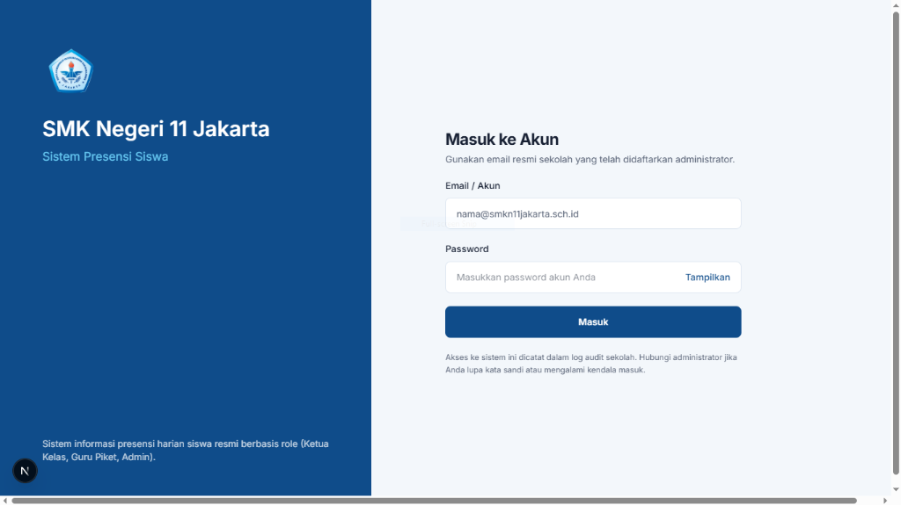
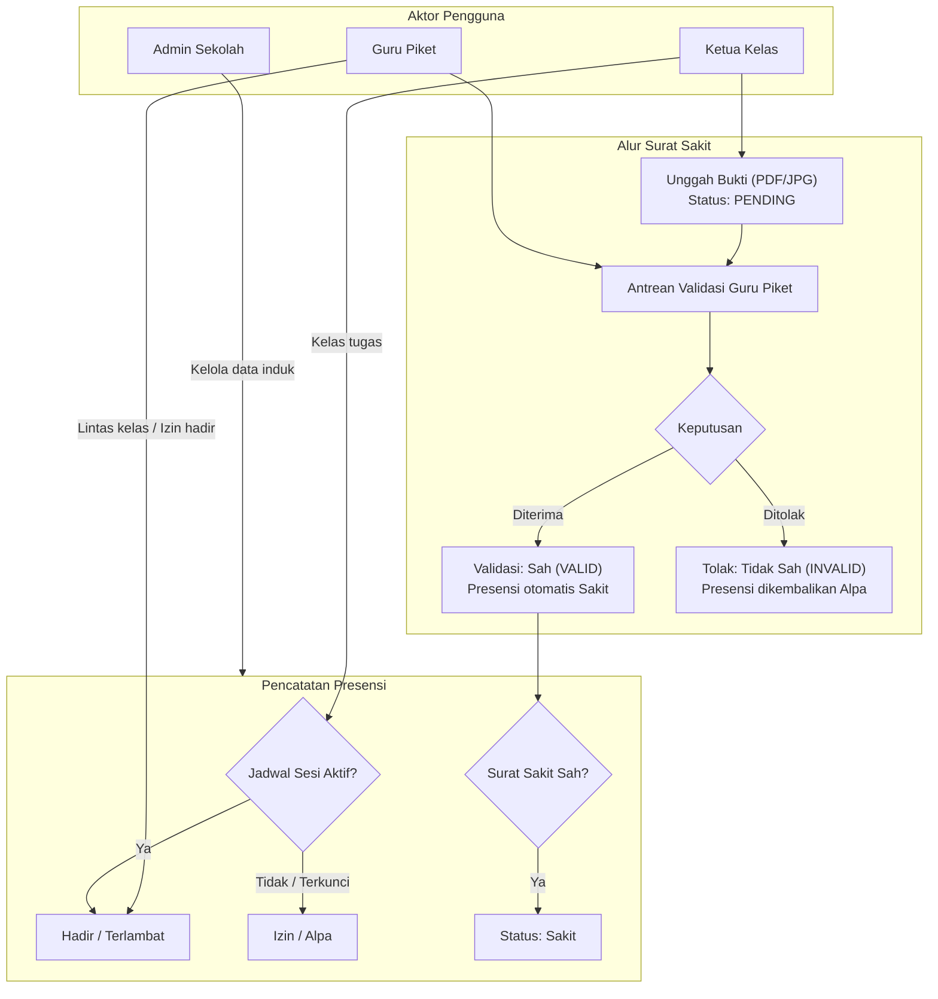

# Sistem Presensi Siswa

Sistem presensi siswa berbasis web yang dirancang untuk pencatatan kehadiran harian, monitoring lintas kelas, dan rekapitulasi sekolah dengan kendali akses berbasis peran (RBAC) serta alur validasi surat sakit terverifikasi.

[](https://github.com/Fachri-analys/presensi-siswa/actions)
[](https://nextjs.org/)
[](https://react.dev/)
[](https://nestjs.com/)
[](https://www.sqlite.org/)
[](https://www.prisma.io/)

---

## Tampilan Antarmuka



---

## Alur dan Hak Akses

Sistem menggunakan model hak akses bertingkat dengan pemisahan wewenang yang tegas:



### Matriks Akses Pengguna

| Peran | Ruang Lingkup | Akses Utama |
|---|---|---|
| **Admin** | Seluruh Sekolah | Pengelolaan akun, data siswa, guru, kelas, jadwal sesi, audit log, serta pengawasan presensi seluruh kelas. |
| **Guru Piket** | Lintas Kelas | Pencatatan presensi lintas kelas, pemberian izin Hadir di luar sesi per siswa, verifikasi dan validasi berkas surat sakit, monitoring harian, dan laporan. |
| **Ketua Kelas** | Kelas Penugasan | Pencatatan presensi siswa di kelasnya, pengunggahan surat sakit, pemantauan status validasi surat, serta peninjauan rekap kelas sendiri. |

---

## Struktur Direktori

```text
.
├── app/                     # Halaman Next.js App Router (route grup & auth)
├── components/              # Komponen antarmuka (dashboard, presensi, dialog, modal)
├── lib/data/                # Kontrak DTO, HTTP client, decoder, dan adapter repository
├── tests/                   # Pengujian unit frontend (Vitest)
├── backend/
│   ├── prisma/              # Skema database, migrasi SQLite, dan berkas seeder
│   ├── src/modules/         # Modul domain NestJS (auth, attendance, sick-letters, dsb.)
│   └── test/                # Pengujian integrasi dan end-to-end (Jest)
├── docs/                    # Spesifikasi API, panduan produksi, dan audit keamanan
├── scripts/                 # Skrip deployment otomatis dan backup produksi
├── Dockerfile               # Konfigurasi container produksi Next.js
└── docker-compose.production.yml # Orkestrasi SQLite, API, Frontend, dan Caddy
```

---

## Menjalankan Aplikasi Secara Lokal

### Prasyarat
- **Node.js** `>=22.12.0` dan **npm** `>=10.0.0`
- Database SQLite lokal (tanpa perlu instalasi server database eksternal)

### 1. Instalasi Dependensi & Konfigurasi Lingkungan

```bash
git clone https://github.com/Fachri-analys/presensi-siswa.git
cd presensi-siswa

# Pasang paket frontend dan backend
npm ci
npm --prefix backend ci

# Salin konfigurasi environment
cp .env.example .env.local
cp backend/.env.example backend/.env
```

> **Catatan Kredensial**: Untuk inisialisasi akun Admin pertama kali, atur `INITIAL_ADMIN_EMAIL` dan `INITIAL_ADMIN_PASSWORD` (minimal 12 karakter memadukan huruf besar, huruf kecil, dan angka/simbol) pada `backend/.env`.

### 2. Migrasi Database dan Seed Awal

Jalankan seluruh perintah persiapan database langsung dari direktori root:

```bash
npm run backend:prisma:generate
npm run backend:prisma:migrate
npm run backend:prisma:seed
```

### 3. Menjalankan Server Development

Buka dua jendela terminal terpisah dari direktori root:

**Terminal 1 — Backend API (Port 4000):**
```bash
npm run backend:dev
```

**Terminal 2 — Frontend UI (Port 3000):**
```bash
npm run dev
```

- **Aplikasi Frontend**: [http://localhost:3000](http://localhost:3000)
- **REST API**: [http://localhost:4000/api/v1](http://localhost:4000/api/v1)
- **Dokumentasi Swagger API**: [http://localhost:4000/api/docs](http://localhost:4000/api/docs)
- **Pemeriksaan Kesehatan (Health)**: [http://localhost:4000/health](http://localhost:4000/health)

---

## Pengujian dan Kualitas Kode

Sistem dilengkapi pengujian otomatis menyeluruh pada frontend dan backend:

```bash
# Pengujian Frontend (Vitest)
npm test
npm run typecheck
npm run lint

# Pengujian Backend (Jest & Prisma)
npm run backend:test
npm --prefix backend run typecheck
npm --prefix backend run lint
```

---

## Deployment Produksi

Deployment menggunakan Docker Compose dengan arsitektur satu server yang efisien: Caddy sebagai reverse proxy dengan TLS otomatis, frontend Next.js, backend NestJS, dan SQLite pada volume persisten terisolasi.

```bash
cp .env.production.example .env.production
chmod 600 .env.production

# Jalankan skrip deployment mandiri
./scripts/deploy-production.sh
```

Cadangan berkas database dan dokumen surat dapat dijalankan secara berkala melalui:
```bash
./scripts/backup-production.sh
```

---

## Referensi Dokumentasi

- [Peta Proyek & Arsitektur](./docs/PROJECT-MAP.md)
- [Spesifikasi Kontrak API](./docs/API-CONTRACT.md)
- [Dokumentasi Modul Backend](./backend/README.md)
- [Panduan Setup Produksi](./docs/PRODUCTION-SETUP.md)
- [Laporan Audit Keamanan](./docs/SECURITY-AUDIT.md)
