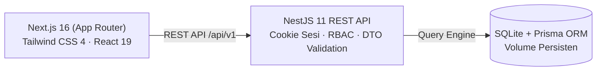

# Sistem Presensi Siswa

Aplikasi presensi sekolah berbasis web dengan kontrol akses berbasis peran (Admin, Guru Piket, Ketua Kelas), pencatatan kehadiran berbasis sesi waktu, serta alur validasi surat sakit terintegrasi.

[](https://github.com/Fachri-analys/presensi-siswa/actions)
[](https://nextjs.org/)
[](https://react.dev/)
[](https://nestjs.com/)
[](https://www.prisma.io/)
[](https://www.sqlite.org/)

---


---

## Fitur Utama

- **Presensi Berbasis Sesi**: Pencatatan status Hadir, Terlambat, Izin, Sakit, dan Alpa dengan batasan jendela waktu aktif (sesi pagi & siang).
- **Verifikasi Surat Sakit**: Ketua Kelas mengunggah bukti surat sakit (`PENDING`) &rarr; Guru Piket/Admin memverifikasi di antrean validasi (`VALID`/`INVALID`) &rarr; presensi otomatis diperbarui ke status `Sakit`.
- **Izin Hadir Luar Jadwal**: Guru Piket dapat memberikan dispensasi pencatatan Hadir/Terlambat per siswa saat sesi terkunci.
- **Monitoring & Rekap Real-time**: Rekapitulasi kehadiran kelas harian, persentase kehadiran, dan ekspor laporan CSV.

### Matriks Akses Peran

| Peran | Ruang Lingkup | Hak Akses |
|---|---|---|
| **Admin** | Sekolah | Kelola akun, data master (siswa, guru, kelas), konfigurasi sesi, dan audit log. |
| **Guru Piket** | Lintas Kelas | Input presensi seluruh kelas, verifikasi surat sakit, dispensasi jadwal, dan pantau rekap. |
| **Ketua Kelas** | Kelas Sendiri | Input presensi kelas penugasan, unggah surat sakit, dan pantau status validasi. |

---

## Arsitektur Sistem



---

## Memulai Cepat (Pengembangan Lokal)

### Prasyarat
- **Node.js** `>=22.12.0` dan **npm** `>=10.0.0`
- SQLite lokal (tanpa perlu server database eksternal)

### 1. Kloning & Instalasi

```bash
git clone https://github.com/Fachri-analys/presensi-siswa.git
cd presensi-siswa

# Instal dependensi frontend dan backend
npm ci
npm --prefix backend ci

# Siapkan file environment
cp .env.example .env.local
cp backend/.env.example backend/.env
```

### 2. Inisialisasi Database

Jalankan migrasi dan seeder awal dari direktori root:

```bash
npm run backend:prisma:generate
npm run backend:prisma:migrate
npm run backend:prisma:seed
```

> **Akun Admin**: Atur `INITIAL_ADMIN_EMAIL` dan `INITIAL_ADMIN_PASSWORD` (min. 12 karakter kombinasi huruf besar, kecil, angka, dan simbol) pada `backend/.env` sebelum seeding.

### 3. Jalankan Aplikasi

Buka dua terminal dari direktori root:

```bash
# Terminal 1: Backend API (port 4000)
npm run backend:dev

# Terminal 2: Frontend (port 3000)
npm run dev
```

- **Frontend**: [http://localhost:3000](http://localhost:3000)
- **API**: [http://localhost:4000/api/v1](http://localhost:4000/api/v1)
- **Swagger Docs**: [http://localhost:4000/api/docs](http://localhost:4000/api/docs)
- **Health Check**: [http://localhost:4000/health](http://localhost:4000/health)

---

## Perintah Pengujian & Kualitas Kode

```bash
# Frontend: Test (Vitest), Typecheck, Lint
npm test
npm run typecheck
npm run lint

# Backend: Test (Jest), Typecheck, Lint
npm run backend:test
npm --prefix backend run typecheck
npm --prefix backend run lint
```

---

## Deployment Produksi

Deployment menggunakan Docker Compose pada satu host terisolasi (Caddy TLS otomatis + Next.js + NestJS + SQLite volume):

```bash
cp .env.production.example .env.production
chmod 600 .env.production
./scripts/deploy-production.sh
```

Cadangan berkas database dan unggahan:
```bash
./scripts/backup-production.sh
```

---

## Dokumentasi Terkait

- [Spesifikasi Kontrak API](./docs/API-CONTRACT.md)
- [Peta Arsitektur Proyek](./docs/PROJECT-MAP.md)
- [Modul Backend API](./backend/README.md)
- [Panduan Setup Produksi](./docs/PRODUCTION-SETUP.md)
- [Panduan Kontribusi](./CONTRIBUTING.md)
