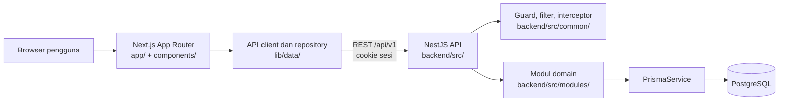

# Peta Proyek

Peta tingkat tinggi repository Sistem Presensi Siswa SMK Negeri 11 Jakarta. Isinya merangkum struktur dan alur utama agar pekerjaan berikutnya bisa langsung menuju area yang relevan; bukan audit setiap file. Diperbarui dari kode pada 25 Oktober 2026.

## Gambaran arsitektur

Repository ini adalah monorepo TypeScript dengan frontend Next.js di root, backend NestJS di `backend/`, dan PostgreSQL yang dimodelkan dengan Prisma.



## Peta direktori

| Lokasi | Peran |
|---|---|
| `app/` | Route dan layout Next.js App Router. Grup `(app)` berisi halaman setelah login; `login/` adalah halaman masuk. |
| `components/` | Shell navigasi, dashboard menurut role, tabel, dialog, presensi, monitoring, dan komponen UI bersama. |
| `lib/data/` | Kontrak repository/DTO frontend, client HTTP, decoder respons, dan adapter untuk auth, sekolah, presensi, monitoring, admin, serta audit. |
| `lib/` selain `data/` | Tipe domain dan fungsi statistik/tanggal. Data operasional dimuat melalui API. |
| `tests/` | Test Vitest frontend untuk client dan adapter API, decoder/kontrak, sesi, tanggal/statistik, serta audit keamanan dependensi. |
| `backend/src/modules/` | Modul NestJS untuk auth, siswa, guru, kelas, akun, presensi, jadwal, monitoring, laporan, surat sakit, dan audit log. |
| `backend/src/common/` | Guard autentikasi dan role, decorator request/user/role, filter error, interceptor request-id/log/timeout, util akses dan tanggal, serta pembersihan sesi. |
| `backend/src/prisma/` | Modul dan service Prisma yang dipakai modul backend. |
| `backend/prisma/` | `schema.prisma`, migrasi, dan seed database. |
| `backend/test/` | Test end-to-end dan helper autentikasi backend; unit test berada di dekat modul dengan akhiran `.spec.ts`. |
| `docs/` | PRD, SRS, kontrak API, handoff backend, indeks dokumen, dan peta ini. |
| `backend/docker-compose.yml` | PostgreSQL lokal; pgAdmin tersedia sebagai profile `tools`. |
| `Dockerfile`, `backend/Dockerfile` | Image produksi frontend dan backend. |
| `.github/workflows/ci.yml` | Pipeline CI yang dirujuk README dan indeks dokumentasi. |

## Route frontend

| Route | Fungsi utama |
|---|---|
| `/login` | Masuk melalui repository auth. |
| `/dashboard` | Memilih dashboard Admin, Guru Piket, atau Ketua Kelas dari sesi. |
| `/presensi` | Alur presensi lintas kelas; detail kelas dapat dipilih melalui query `kelas`. |
| `/siswa`, `/guru`, `/kelas`, `/pengaturan` | Data siswa, guru, kelas, serta jadwal dan akun/pengaturan. Pembatasan tampilan role dilakukan dengan `RoleGate` dan navigasi shell. |
| `/monitoring`, `/monitoring/[kelas]` | Ringkasan lintas kelas dan rincian kelas. |
| `/riwayat`, `/laporan` | Riwayat dan rekap/cetak/ekspor laporan. |
| `/log-aktivitas` | Tampilan aktivitas. |

`components/app-shell.tsx` memeriksa sesi API melalui `auth/me` dan menyediakan konteks user/role. `proxy.ts` mengarahkan route terlindungi berdasarkan keberadaan cookie sesi; otorisasi data dan role tetap tanggung jawab backend, bukan proxy atau `RoleGate` frontend.

## Backend dan data

`backend/src/main.ts` memasang prefix `/api/v1`, validasi DTO global, CORS dengan credentials, Helmet, cookie parser, kompresi, Swagger non-production, serta shutdown hooks. `AppModule` mendaftarkan rate limiting, guard global, interceptor, exception filter, Prisma, health, dan modul domain.

| Modul | Cakupan |
|---|---|
| `auth` | Login, logout, dan sesi saat ini. |
| `users`, `students`, `teachers`, `classes` | Akun/role, data siswa dan guru, kelas, serta penugasan ketua kelas. |
| `attendance`, `schedules` | Presensi per kelas/tanggal, simpan batch, riwayat/rekap, serta aturan jadwal sesi. |
| `monitoring`, `reports` | Ringkasan kehadiran per kelas, laporan per kelas/per siswa, dan ekspor CSV. |
| `sick-letters` | Unggah dan pencatatan surat sakit/izin. |
| `audit-logs` | Pembacaan log perubahan. |
| `health` | Health check API dan koneksi database. |

Model Prisma utama: `User` dan `Session`; `Teacher`, `Student`, dan `Class`; `Attendance` dan `AttendancePermission`; `Schedule`; `SickLetter`; serta `AuditLog`. Presensi memiliki batas unik tanggal-kelas-siswa. Role adalah `KETUA_KELAS`, `GURU_PIKET`, dan `ADMIN`; data sekolah dapat berstatus `active` atau `inactive`. Tanggal presensi disimpan sebagai tanggal database tanpa waktu, dan aturan jadwal memakai zona sekolah `Asia/Jakarta`.

## Alur data yang perlu diketahui

1. Frontend membuat API client dari `NEXT_PUBLIC_API_BASE_URL` dan mengirim cookie (`credentials: include`). Decoder di `lib/data/decoders.ts` memvalidasi bentuk respons sebelum masuk ke tipe UI.
2. Backend mengambil user dari sesi server; `AuthGuard` dan `RolesGuard` menjadi batas autentikasi/role. Service domain memvalidasi cakupan objek, menjalankan Prisma, dan mencatat audit sesuai operasinya.
3. Layar aplikasi mengambil data sekolah, presensi, jadwal, laporan, surat sakit, dan audit dari backend. Bila API belum dikonfigurasi atau gagal, layar menampilkan pesan kesalahan dan tidak mengganti hasil dengan data lokal contoh.
4. Status presensi API adalah `HADIR`, `TERLAMBAT`, `IZIN`, `SAKIT`, dan `ALPA`. Di rekap, “Hadir” mencakup “Terlambat”; terlambat ditampilkan sebagai rincian.

## Titik sambungan untuk pekerjaan berikutnya

- Kontrak frontend berada di `lib/data/contracts.ts`; implementasi request dan decode ada di `lib/data/api-*.ts` dan `lib/data/decoders.ts`.
- DTO, route controller, aturan role, dan logika bisnis backend masing-masing ada di `backend/src/modules/<modul>/`.
- Adapter dan controller presensi menyediakan batch create/update, update record, delete record, serta pemberian izin hadir per siswa.
- Frontend menyediakan `getReport()` melalui `GET attendance/recap`; backend juga memiliki modul `reports` dengan endpoint laporan dan ekspor CSV. Tentukan jalur yang digunakan layar tertentu sebelum mengubah format atau perhitungan.
- `API-CONTRACT.md` adalah draf rancangan, bukan daftar lengkap route aktif. Cocokkan dengan controller, DTO, test, dan Swagger non-production. PRD/SRS tetap memuat kebijakan sekolah yang belum diputuskan; gunakan [PRODUCTION-SETUP.md](./PRODUCTION-SETUP.md) untuk langkah setup operasional.

## Menjalankan dan memvalidasi

Jalankan dari root repository. Siapkan `.env.local` dari `.env.example` dan `backend/.env` dari `backend/.env.example` sebelum menjalankan aplikasi.

```bash
npm install
npm --prefix backend install
npm run docker:db
npm run backend:prisma:generate
npm --prefix backend run prisma:migrate
npm run backend:prisma:seed
npm run backend:dev
npm run dev
```

Frontend tersedia di `http://localhost:3000`; backend di `http://localhost:4000`; Swagger di `http://localhost:4000/api/docs` saat backend bukan production. Test frontend: `npm test`. Test backend: `npm run backend:test`; test e2e: `npm --prefix backend run test:e2e`. Typecheck: `npm run typecheck` dan `npm --prefix backend run typecheck`.

## Dokumen terkait

- [PRD](./PRD.md) — tujuan, aktor, cakupan, dan aturan produk.
- [SRS](./SRS.md) — kebutuhan fungsional/nonfungsional dan kriteria penerimaan.
- [API Contract](./API-CONTRACT.md) — resource, payload, error, dan autentikasi.
- [Backend Handoff](./BACKEND-HANDOFF.md) — gambaran handoff dan kesiapan operasional backend.
- [Panduan kontribusi](../CONTRIBUTING.md) — alur perubahan dan ketentuan repository.
